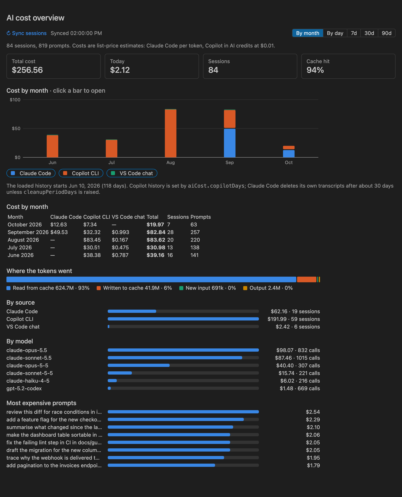
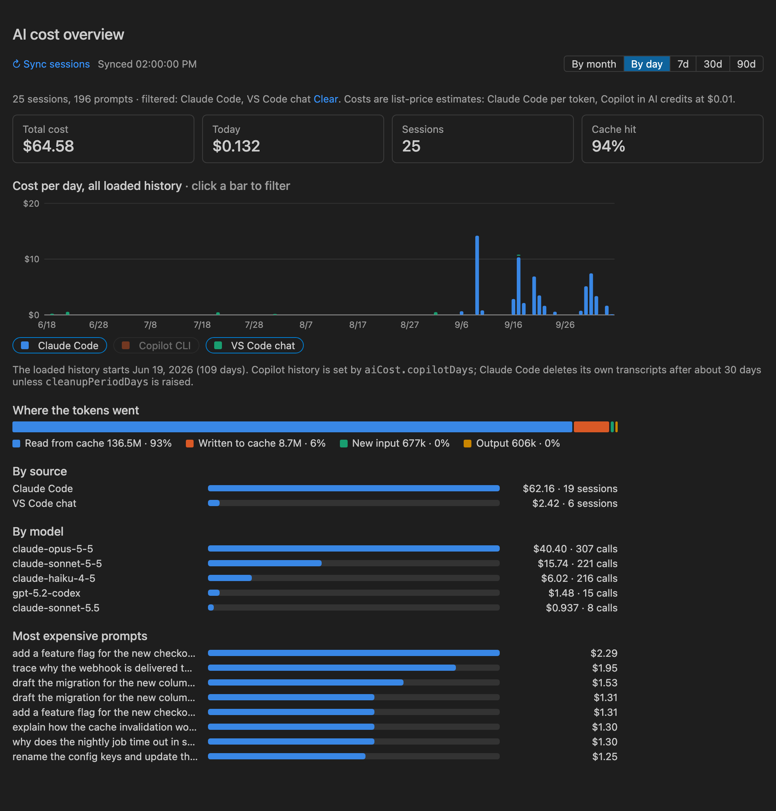
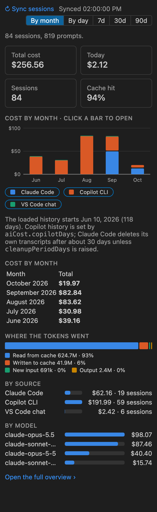
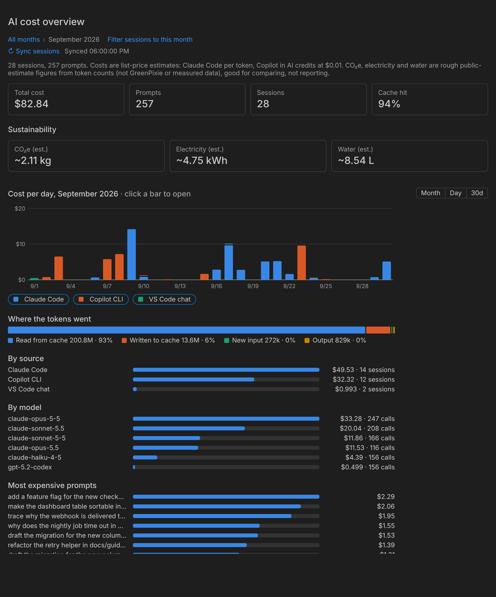
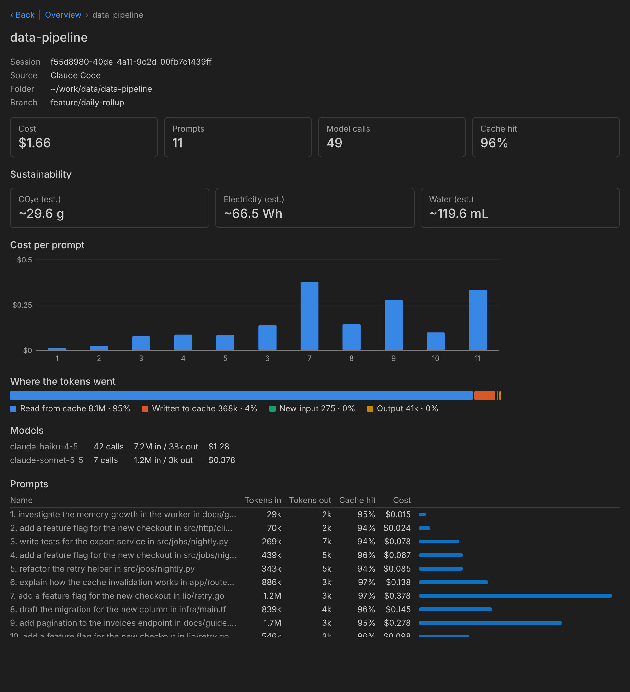
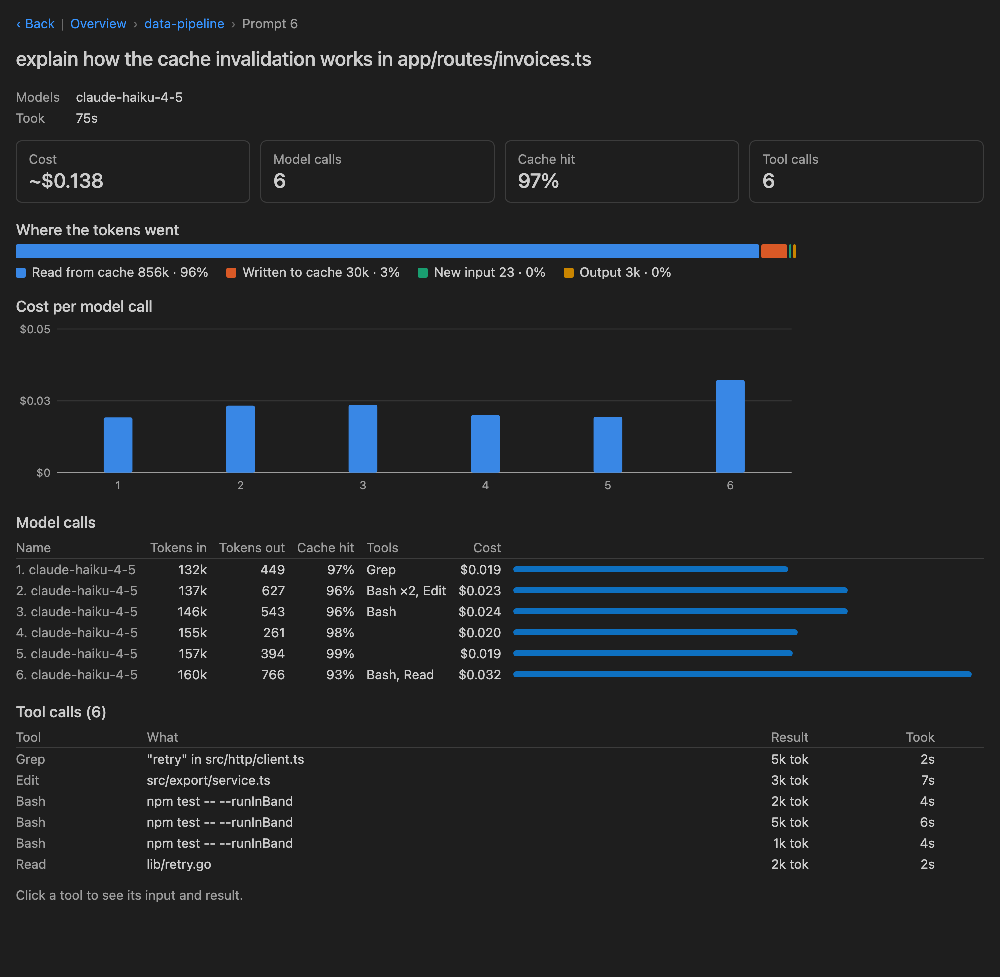
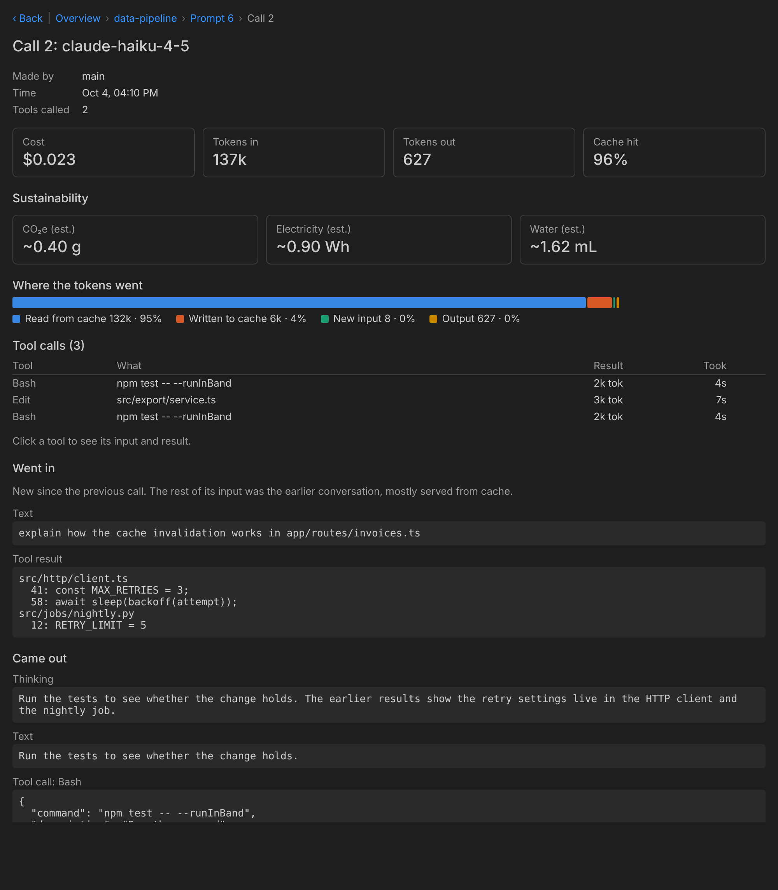
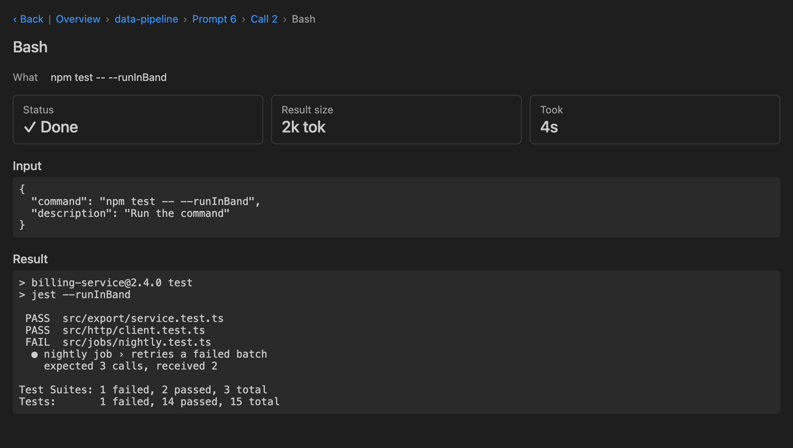
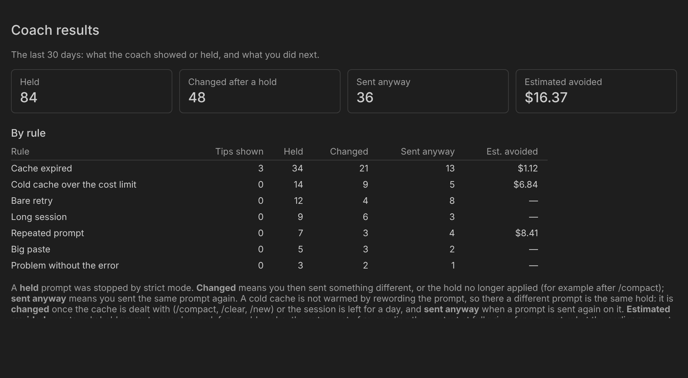

# AI Cost Coach for VS Code

See where your AI spend goes, from a month down to a single tool call, for **Claude Code**, **GitHub Copilot CLI** and
**VS Code Copilot Chat**. A coach holds the prompts that would waste money, and a daily budget keeps your Copilot premium
requests in check.



*Every screen in this README is one of the extension's own panels, drawn from made-up sample sessions. Nothing in
the images comes from anyone's real logs.*

## Install

You need **VS Code 1.90 or newer** (Node.js 18+ only for [Copilot tracking](#copilot-tracking-and-cost-tips)). Download
the `.vsix` from the [releases](https://github.com/techsalvator/ai-coach/releases) and install it:

```bash
gh release download --repo techsalvator/ai-coach --pattern '*.vsix'
code --install-extension ai-cost-coach-*.vsix
```

Then run **Developer: Reload Window**. The extension's ID is `techselva.ai-cost-coach`; if you had AI Cost Drilldown
(`flexera.ai-cost-drilldown-vscode`) installed, uninstall it, or both will run. Your Claude Code and Copilot sessions load by themselves: no sign-in, no key.
To update, install the newer file over it. Coming from the old Copilot CLI plugin? Setting up Copilot tracking offers to
remove it; the `/cost` command inside Copilot is gone, the reports are in VS Code.

## The screens

Run **AI Cost: Show Tour** (or Help → Get Started → AI Cost Coach) for a walkthrough. The extension's page in the
Extensions view shows this text without the images, because VS Code only loads images there from public `https` addresses.

- **Overview.** Opens in an editor tab: tiles (total, today, this month, sessions, cache hit), this month's cost for each
  tool, **Sustainability** tiles (below), **cost by month** stacked by tool, tokens, and cost by source, model and
  prompt. **Month · Day · 30d**, beside the chart heading, changes the range. **The legend is the tool selector:** click a tool to
  leave it out (the same filter as **Filter → Source**, so the tree, Advice and status bar follow). Almost everything is
  clickable: a bar filters or opens that month, day, model or prompt.

  

- **The sidebar** has four panels: a compact **Overview**, **Sessions** (a tree: session → prompt → model call), **Advice**
  and **Coach**.

  

- **A month.** Click a month to see its days; a breadcrumb takes you back.

  

- **A session** shows its cost per prompt, where its tokens went, its models and every prompt.

  

- **A prompt** shows its model calls, cache hit, token split and tool calls, with a **breadcrumb and Back button**.

  

- **A model call** shows **what went in** (what was new since the previous call) and **what came out** (reply, reasoning
  where recorded, tool requests).

  

- **A tool call** shows its full **input** and **result**, with status, size and time.

  

**Filter** (the funnel in the Sessions title bar) narrows by source, day, model, minimum prompt cost and text; **Sort**
orders by time, cost, tokens, cache hit or calls; **Sync** reads the logs again (they are also re-read every minute).

### Copilot premium requests and the daily budget

Under the tiles, a bar shows your plan's premium requests used and left this month, the reset date, and where the month
will end at this pace. The numbers are the ones Copilot CLI writes into its own log, so nothing needs configuring (Claude
Code has no such quota, and the panel is hidden on unlimited plans). The status bar carries it:
`AI today $1.20 · Copilot 6,832 left (89.9%) · 3/16/day`, and turns to a warning colour when the month is on pace to go
over or today is over budget.

The **daily budget** is what is left spread over the weekdays remaining (none at weekends), or your own number: **Daily
budget (premium requests)** in the Coach panel, or `cost coach budget 50` in a terminal (`budget auto` goes back). Today's
use is what this machine's Copilot sessions used since midnight. In strict mode the first prompt after it is reached is
held, once a day.

The **model guard** says so once when requests are on pace to run out, naming the models that cost you the most requests
a prompt and the cheaper one you already use most. It advises only: it never hides or switches a model.

## Advice

The Advice panel measures your own sessions and lists where spend could be cut, each with an estimated saving and the
prompts behind it: **prompt cache expired between prompts**, **model switched mid-session**, **top-tier model on short
replies**, **very long conversations** (over 150k tokens of context), and **a few prompts carry the spend**. Savings
overlap, so they do not add up. Under them, unused habits are listed with no saving of their own: `/compact` never used
in a long session, no project instructions file, a token logger that is not recording, or cost tips switched off.

## Copilot tracking and cost tips

Without setup, Copilot sessions already show credits, dollars and prompt tokens from Copilot CLI's log and VS Code's chat
storage. **Copilot tracking** adds **per-call tokens** (a small Copilot CLI extension records every model call; prompts it
did not see show "No token data") and **the coach**, a prompt hook that checks each prompt before it runs in Copilot CLI
and VS Code chat.

Turn it on with **Copilot tracking** in the Coach panel, or **AI Cost: Set Up Copilot Tracking**. It asks first and lists
what it writes: the hook (`~/.copilot/hooks/ai-cost-coach.json`), the token logger (`~/.copilot/extensions/ai-cost/`)
and the hook's scripts (`~/.ai-cost-coach/runtime/`). Copilot CLI loads extensions only in experimental mode: run
`/experimental on` once, then start a new session. **Remove Copilot Tracking** deletes the three.

**The switches** (Coach panel; set by environment variables such as `AI_COST_COACH_STRICT` when those are present):
**Coach** (a one-line tip when a prompt is about to cost more than it needs to, on), **Strict mode** (hold the prompt with
a banner instead; send the same prompt again to run it, on), **Hold on every cache expiry** (on), **Strict model** (the
banner also carries the prompt reworded by a small model, off) and **Model guard** (on).

| Strict mode holds | When | Held |
|---|---|---|
| **Cold cache over the cost limit** | The cache expired and re-sending the context would cost $0.50 or more for the first call | every expiry |
| **Cache expired** | A session of 5+ prompts sat idle past the cache lifetime (5 min for Claude, 30 for GPT, or what your log shows) | every expiry |
| **Long session** | Context of 150k tokens or more (21+ prompts without the token log) | once per session |
| **Daily budget** | Today's premium requests reached the budget | once a day |
| **Big paste** | 12,000+ characters pasted, re-sent on every later call | every time |
| **Repeated prompt** | The same prompt already ran in this session; the banner says what it cost | every time |
| **Thin prompt** | Nothing to work on ("clean up the code"), a problem without the error ("fix the bug"), several asks in one, a bare retry | every time |

A banner says why, gives a **Tip** on what to change, and lists every rule that applied (**Also:**). With strict mode off
each is a one-line tip. Questions, "yes", follow-ups, anything naming a file, ticket or number, "fix the failing tests",
`/compact`, `/clear`, `/new` and the prompts Copilot sends by itself are never held.

**In VS Code chat** a blocked prompt would just vanish, so the hook blocks only while this extension is running to show
why. Each hold is a notification: **Why** (the full banner), **Send anyway**, **Copy prompt**. With no window open, or
`aiCost.notifyHeldPrompts` off, you get a tip instead.

**Coach results** shows the last 30 days: tips shown, prompts held, whether you changed the prompt or sent it anyway, and
an estimated cost avoided (list prices, not a measurement). The limits (**Cost limit**, **Long session**, **Daily budget**,
**Big paste**, **Model guard: costly from**) are editable there, and **Pause strict mode** stops holds for a while.



**The coach learns** your cache lifetime from the gaps in your token log (it overrules the documented 5 or 30 minutes only
with five or more telling gaps) and checks its cold-cache warnings against the next call. Both need the token logger.

**If the hook does not run.** VS Code starts hooks with a thin `PATH`, so a bare `node` fails and prompts run unchecked.
Setup writes the absolute path to node, and **AI Cost: Check Copilot Tracking** runs the hook the way VS Code does and
tells you whether it works (it also runs after setup and at startup). A failure inside the hook is written to
`~/.ai-cost-coach/hook-errors.jsonl`. On Windows the hook file names a small `hook.cmd` that runs from cmd.exe,
PowerShell and Git Bash alike.

## Reading the numbers

**Costs are estimates.** Claude Code's cost is each model's list price applied to its transcript's tokens; Copilot's is
the AI credits it recorded, at **$0.01 per credit**, with each call priced at GitHub's published token prices. Subscription
usage is not billed per token: these are list-price figures for comparing where usage went. **Cache:** every call re-sends
the whole conversation, normally from a cheap cache; a prompt that starts with a miss pays full price for all of it.
**Sources:** `~/.claude/projects/`, `~/.copilot/session-state/` and VS Code's chat storage.

**Sustainability is a rough estimate, not a measurement.** The **Sustainability** tiles (overview, session, prompt and
model call) show estimated **CO₂e**, **electricity** and **water** for the tokens in your logs; every figure carries a
`~`, and **hovering a tile shows the sum with your actual numbers**. Electricity comes first: output tokens, plus fresh
input at 0.1, cache writes at 0.1 and cache reads at 0.01 of an output token, times an energy figure for the model's size
(0.0003 Wh per output token for small models such as Haiku, 0.0007 for medium such as Sonnet and GPT, 0.0015 for large such
as Opus; models it does not recognise count as medium), times a data-centre overhead (PUE) of 1.2. **CO₂e** is that
electricity at 445 g per kWh, the global average grid. **Water** is that electricity at 1.8 L per kWh of cooling. These are
public-estimate assumptions (Mistral's lifecycle assessment, Google and OpenAI's per-prompt disclosures, Ember/IEA grid
data, a Berkeley Lab data-centre report), good to an order of magnitude at best, and they are **not GreenPixie data and
not vendor-measured**: use them to compare prompts and models, not to report a footprint. The factors and their sources
are in `lib/emissions-factors.json`; replace that file to use your own.

## Settings and commands

Where to change things: the settings below are in **VS Code Settings** (search `AI Cost`, or `aiCost.` in
`settings.json`). The coach's **switches and limits** (strict mode, the daily budget and the rest) are in the **Coach
panel** in the sidebar, and are saved in `~/.ai-cost-coach/config.json`. Commands are in the Command Palette under
**AI Cost: …**.

| Setting | Default | What it does |
|---|---|---|
| `aiCost.openOverviewOnSelect` | on | Open the overview in a tab when you select the AI Cost icon |
| `aiCost.maxSessions` | 500 | How many recent Claude Code transcripts to read |
| `aiCost.copilotDays` | 90 | How many days of Copilot history to load |
| `aiCost.sources` | `claude`, `copilot` | Which tools to load sessions from |
| `aiCost.refreshSeconds` | 60 | How often to read the logs again |
| `aiCost.notifyHeldPrompts` | on | Show held prompts in VS Code chat as notifications |

From a terminal, the same switches are `node ~/.ai-cost-coach/runtime/bin/cost.js coach [on|off|strict on|off|budget <n>|auto]`
(it writes the same `config.json`, so the Coach panel shows the change). Only the extension's own commands are on the
Command Palette: there is no `cost` command on your `PATH`.

## Your data and privacy

The extension reads session logs that already exist on your machine, which include your prompt text, folders and branch
names. It sends nothing anywhere and needs no account or key. The one exception is **Strict model**, which sends the held
prompt, the session's last few prompts and answer, its last failed tool result and the branch name to a small model
through your own `copilot` command. It writes nothing to those logs. Its own files are in `~/.ai-cost-coach/`
(`AI_COST_HOME` changes it); [Copilot tracking](#copilot-tracking-and-cost-tips) is the only thing that writes outside it,
and only after you agree.

## What it cannot do

- Recover tokens it did not record, or give per-call detail for VS Code chat (one total per request).
- Show Claude's reasoning or Copilot's full replies.
- Go back past what the tools keep (Claude Code deletes transcripts after about 30 days unless `cleanupPeriodDays` is raised).
- Give bill-accurate totals: it reports what the tools logged on this machine.
- Coach Claude Code (its sessions are measured; tips and strict mode act on Copilot only), or hold a prompt the hook
  never saw. If the hook cannot run, Copilot lets the prompt through, which is why **Check Copilot Tracking** exists.

Checked live: strict mode in a Copilot session inside VS Code. Not yet checked: the classic Copilot Chat panel, a hold in
a live Copilot session on Windows, and the token logger across Copilot CLI updates.

## Develop

```bash
cd vscode-extension
npm test                         # node --test, no dependencies
npm run package                  # build the .vsix into ../dist (not committed)
```

Open `vscode-extension/` in VS Code and press F5 to try it without installing. The report code is in `lib/`, the hook in
`bin/cost.js`, the token logger in `extensions/ai-cost/`, the extension in `vscode-extension/`.

**Releasing.** A pull request that changes what the extension ships (`vscode-extension/` except tests, scripts, README and
CHANGELOG; or `lib/`, `bin/`, `extensions/`) must raise the version in `vscode-extension/package.json` and add a
`## <version>` section to `vscode-extension/CHANGELOG.md`; the **Version bump** check fails otherwise. The
[workflow](.github/workflows/vscode-extension.yml) tests every pull request, and on a merge to `main` with a version that
has no release yet it tags `vscode-v<version>` and publishes a release with the `.vsix` and the CHANGELOG section. What
changed is in the [changelog](vscode-extension/CHANGELOG.md).
