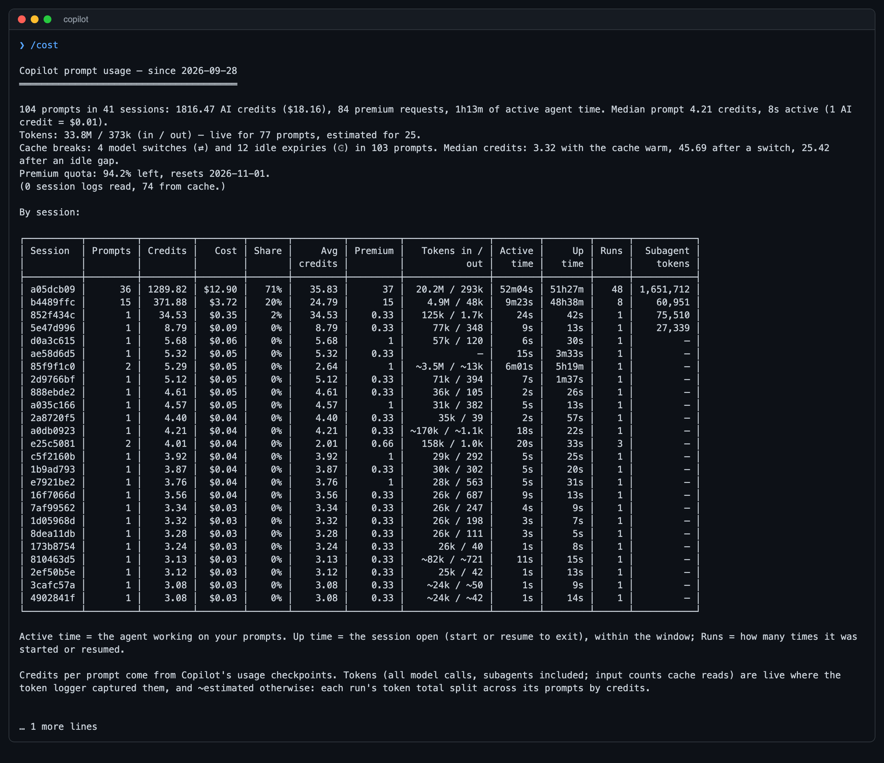
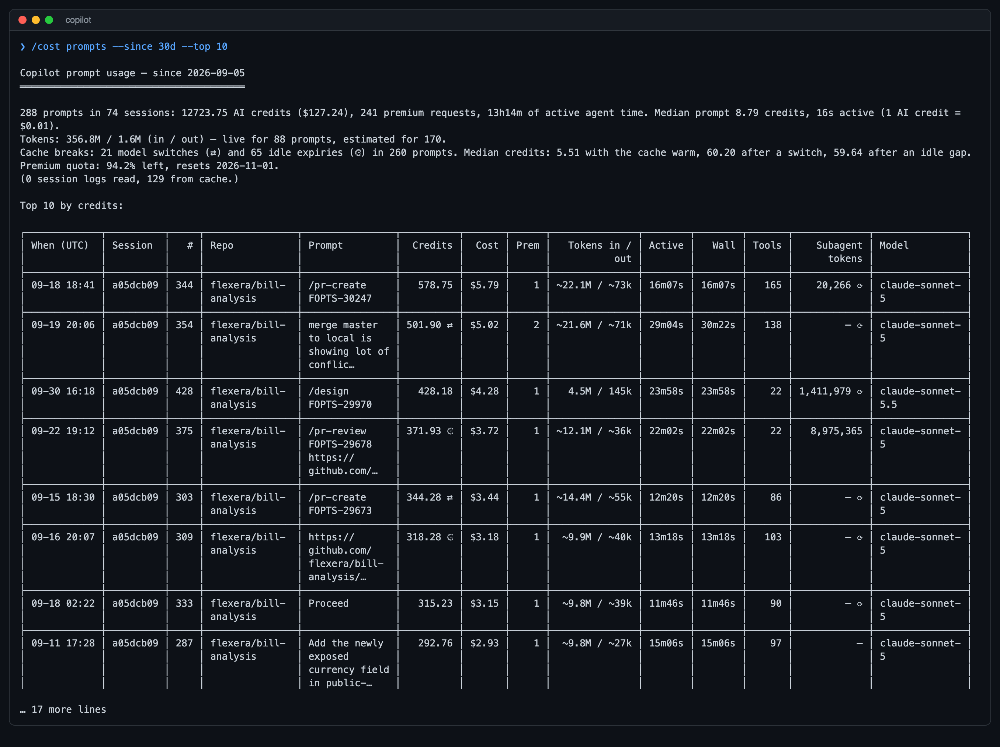
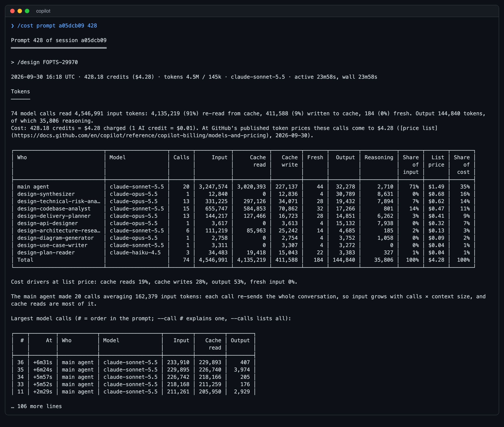
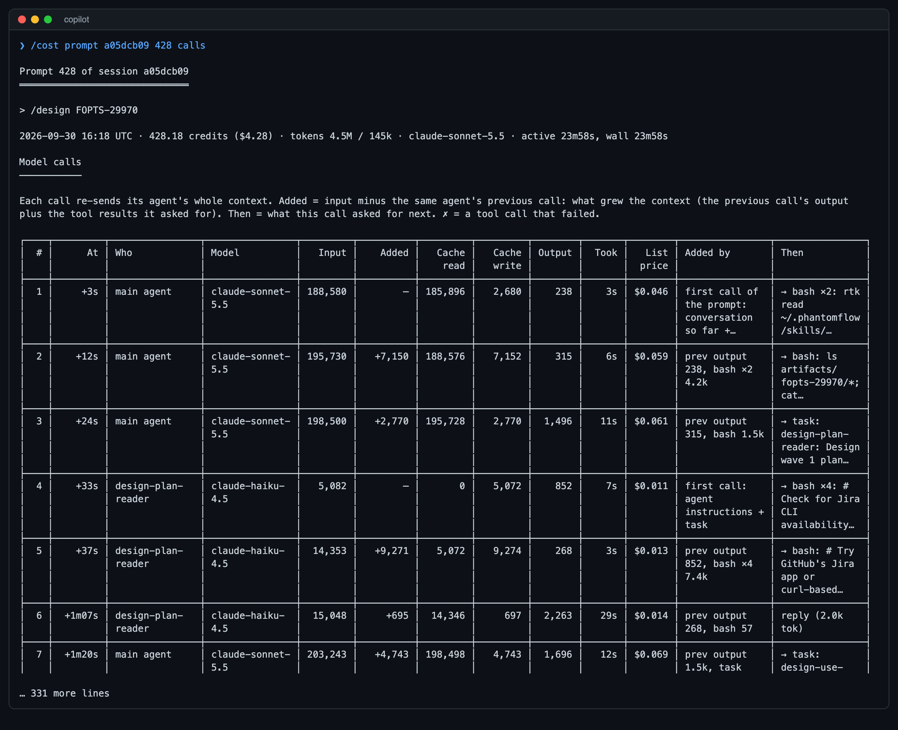
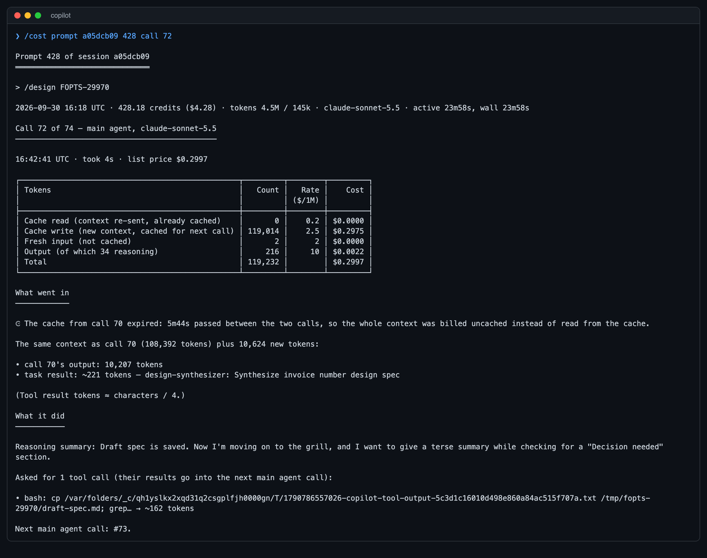
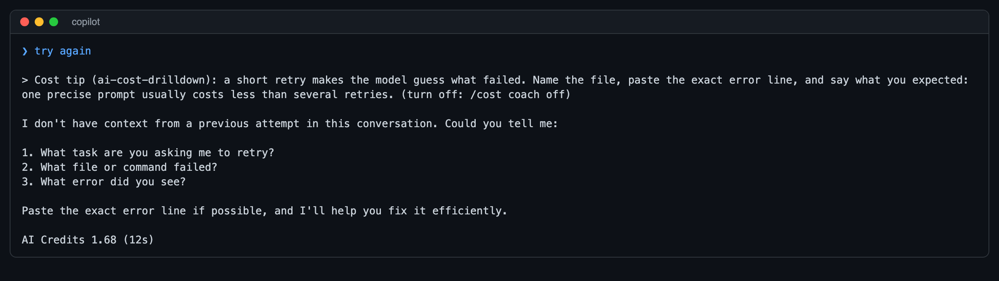
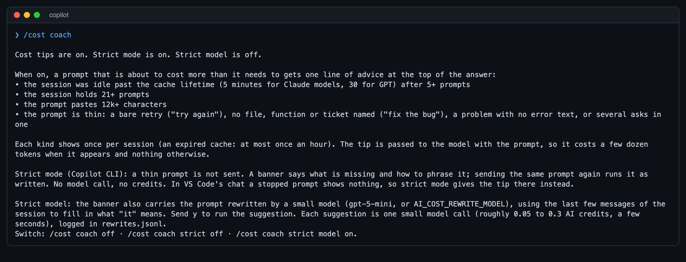
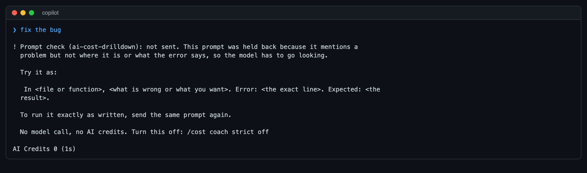
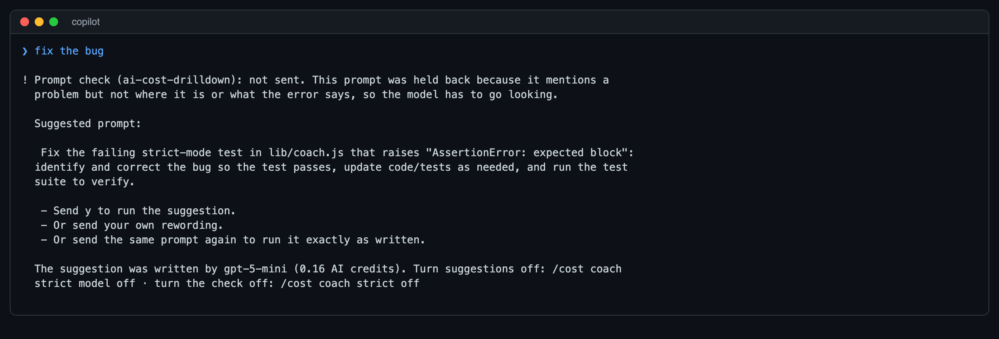

# ai-cost-drilldown

See where your AI spend goes, for **GitHub Copilot CLI**, **VS Code Copilot Chat** and **Claude Code**.

It reads the session logs these tools already keep on your machine and answers questions like:

- What did the last week cost, and which session, prompt, skill or Jira epic was it?
- Why did this one prompt cost $4? Which model call, which subagent, which tool result?
- Where can I cut spend?

Reading a report makes **no model call**: it costs no AI credits and no tokens. Nothing leaves your machine, no
API is called, and no credentials are needed.

## Contents

- [Quick start](#quick-start)
- [The two command names](#the-two-command-names)
- [Commands](#commands)
- [A typical drill-down](#a-typical-drill-down)
- [Cost tips while you type](#cost-tips-while-you-type)
- [Reading the numbers](#reading-the-numbers)
- [VS Code](#vs-code)
- [Claude Code](#claude-code)
- [Cost per epic: how prompts are attributed](#cost-per-epic-how-prompts-are-attributed)
- [What it cannot do](#what-it-cannot-do)
- [Develop](#develop)

Setup details, configuration and troubleshooting are in [INSTALL.md](INSTALL.md).

## Quick start

1. Install the Copilot CLI plugin (it asks before changing anything):

   ```bash
   npx github:flexera/ai-cost-drilldown
   ```

2. In Copilot, turn extensions on once, then start a new session:

   ```
   /experimental on
   ```

3. Type:

   ```
   /cost
   ```

You get the last 7 days across all sessions. From there, `/cost help` lists everything.

Needs Node.js 18+ and access to this repository. Copilot CLI is needed only for the parts that run inside it:
without it the installer sets up the VS Code chat hook and tasks alone. To try it without installing, run
`copilot --plugin-dir <your clone>`. When VS Code is installed the installer also adds the chat hook and the tasks (see [VS Code](#vs-code)); for Claude Code nothing is installed,
see [Claude Code](#claude-code).

## The two command names

The plugin gives you the same reports under two names. Both cost no credits.

| Name | Needs `/experimental on`? | How it is answered |
|---|---|---|
| `/cost` | Yes | by the plugin's extension, inside Copilot |
| `/ai-cost-drilldown:cost` | No | by a hook that runs the report and returns it in place of a model reply |

Use `/cost` if you have experimental mode on. `/ai-cost-drilldown:cost` is there for everyone else: Copilot always
prefixes a plugin's own command with the plugin's name, so it cannot be shortened. In prompt mode,
`copilot -p "/cost …"` works too.

Only the extension can record the tokens of each model call, so **without experimental mode the token figures of new
prompts are estimates** (marked `~`) and the per-call views are unavailable. Credits and dollars are exact either way.
See [Reading the numbers](#reading-the-numbers).

The rest of this page writes `/cost`, except the drill-down walkthrough; every command works with either name.

## Commands

### All sessions

| Command | Shows |
|---|---|
| `/cost` | The last 7 days: the total, and one row per session (prompts, credits, dollars, tokens, active time, up time) |
| `/cost prompts` | The 25 most expensive prompts across sessions, each with its session and prompt number (`#`) |
| `/cost prompts --by day` | Totals grouped by day. Also `--by session`, `skill`, `repo`, `branch`, `model`, `source` |
| `/cost list` | Recent sessions, to find a session id |

Options for `prompts`: `--since 7d|30d|all|2026-09-01`, `--top N`, `--sort credits|time|wall|tokens|tools|recent`,
`--grep TEXT`, `--repo TEXT`, `--source all|cli|vscode`, `--csv` (writes a file and prints its path).

### One session

| Command | Shows |
|---|---|
| `/cost session` | The session you are in: the last 20 prompts, each with its number, credits, dollars, tokens, model, tools, subagents and time |
| `/cost session --all` | Every prompt of this session (`--last 50` for the last 50) |
| `/cost 20` | Shorthand for this session's last 20 prompts |
| `/cost session a05dcb09` | Another session, by id or the first characters of it |

### One prompt

Prompt numbers come from the `#` column of `/cost session` or `/cost prompts`.

| Command | Shows |
|---|---|
| `/cost prompt 12` | Prompt 12 of this session: tokens by agent and model, cost at list price, every tool call |
| `/cost prompt 12 calls` | Every model call of that prompt: what made its input grow, what it did next, what it cost |
| `/cost prompt 12 call 5` | One model call in full: cost per token type, what went in, its reasoning summary, the tools it asked for |
| `/cost prompt a05dcb09 428` | The same for **any session, without switching to it**. Add `calls` or `call K` as above |

`a05dcb09:428` and `/cost session a05dcb09 prompt 428` mean the same as the last row.

### Tools, tickets and advice

| Command | Shows |
|---|---|
| `/cost tools` | Which tool calls drive cost. `--by tool\|command\|call`, `--since`, `--scope main\|subagents\|all`, `--top N` |
| `/cost session a05dcb09 tools` | The same for one session |
| `/cost epics` | Cost per Jira epic over 30 days. `--stories` lists every ticket, `--key FOPTS-123` breaks one down, `--unattributed` lists prompts tied to no ticket |
| `/cost advise` | Where spend can be cut, measured on your own sessions, with an estimated saving per finding |
| `/cost help` | All commands |

## A typical drill-down

Five commands, from the overview down to a single model call. Run them in order: each uses what the one before
showed. They are written with the long name, which works for everyone; with experimental mode on, `/cost` does the same.

**1. Which sessions cost the most this week?**

```
/ai-cost-drilldown:cost
```

The last 7 days: the total, and one row per session. Note the id of the session at the top.



**2. Which prompts were the expensive ones?**

```
/ai-cost-drilldown:cost prompts --since 30d --top 10
```

The 10 costliest prompts across all sessions, each with its session and prompt number (`#`). Note one pair, for
example session `a05dcb09`, `#` 428.



**3. Where did that prompt's money go?**

```
/ai-cost-drilldown:cost prompt a05dcb09 428
```

Tokens and cost by agent and model (the main agent against each subagent), the share that was cache reads, cache
writes and output, and every tool call the prompt made.



**4. Which model call was it, and what filled its context?**

```
/ai-cost-drilldown:cost prompt a05dcb09 428 calls
```

Every model call in order: how much its input grew, what added it, what the call did next, and its cost. Look for
`⏲` and `✕` (the cache was missed) and for a jump in the Added column.



**5. One call in full**

```
/ai-cost-drilldown:cost prompt a05dcb09 428 call 72
```

That call's cost per token type, what went into it, its reasoning summary and the tools it asked for.



The screenshots are real output, cut after the first 46 lines; `node scripts/screenshots.js` regenerates them
(`--set coach` for the cost-tips ones, which sends four small prompts through Copilot).
Replace `a05dcb09`, `428` and `72` with what the earlier steps show you. Steps 4 and 5 need per-call tokens, so they
work only for prompts the extension recorded; older ones answer "No live token records" (see
[Reading the numbers](#reading-the-numbers)).

Three more that are useful on their own:

| Command | Answers |
|---|---|
| `/ai-cost-drilldown:cost epics --key FOPTS-29970` | What did this epic cost, by skill, ticket, day and session? |
| `/ai-cost-drilldown:cost advise` | Where can spend be cut, and by roughly how much? |
| `/ai-cost-drilldown:cost prompts --since all --by source` | How does Copilot CLI compare with VS Code chat? |

## Cost tips while you type

`/cost advise` tells you afterwards where the spend went. Cost tips say it at the moment it is about to happen:
when a prompt is going to cost more than it needs to, one line appears above Copilot's answer.
A prompt too thin to act on (the last four rows) is held back in Copilot CLI until it is rephrased or sent again:
see [strict mode](#strict-mode-hold-a-thin-prompt-back), which is on by default.

| Tip | When it appears |
|---|---|
| Cache expired | The session was idle past the cache lifetime (5 minutes for Claude models, 30 for GPT) after 5 or more prompts, so this prompt re-reads the whole conversation at full price |
| Long session | The session holds 21 or more prompts, all re-sent on every model call |
| Big paste | The prompt carries 12,000 or more characters of pasted text |
| Bare retry | The prompt is only "try again", "fix it", "still not working" and the like |
| Nothing to work on | A short prompt names no file, function or ticket: "clean up the code", or "make it faster" as a session's first prompt |
| Problem without the error | A short prompt mentions an error or failure but not where or what it says: "fix the bug", "getting an error on build" |
| Several asks in one | A short prompt strings separate tasks together with "also … also …" |



- At most one tip per prompt, and each kind once per session (an expired cache: at most once an hour).
- A hook cannot print to the chat without stopping the prompt, so the tip is handed to the model along with
  the prompt and the model shows it first. It costs a few dozen tokens when a tip appears and nothing
  otherwise. The model usually repeats it word for word, but it is the model's reply: it can occasionally
  leave it out.
- In VS Code's chat (with the [chat hook](#vs-code)) the tip is appended to the prompt instead, because VS Code
  drops a hook's added context when it adds its own. Your words are sent unchanged.
- Everything is decided locally from the prompt text and the session's own log. Nothing is sent anywhere.
- `/cost coach` shows the state; `/cost coach off` and `/cost coach on` switch it (or `AI_COST_COACH=0`).

  

- The prompt checks are patterns, not a model: they catch prompts that are plainly thin, not ones that are subtly
  unclear. Questions, answers ("yes", "continue"), skills and anything naming a file, identifier, ticket, link,
  number or quoted text are never flagged. Run over about 3,600 prompts from one developer's history, they flagged under 1%.

### Strict mode: hold a thin prompt back

```
/cost coach strict off
/cost coach strict on
```

On by default. In Copilot CLI a thin prompt (the last four rows above) is **not sent**. A banner says
what is missing and how to phrase it:



- No model call and no AI credits for the held prompt.
- Sending the same prompt again runs it as written, so a wrong call never blocks you.
- It applies every time, not once per session. The session tips (cache expired, long session) stay tips.
- In VS Code's chat a stopped prompt shows nothing, so strict mode gives the tip there instead.
- With strict mode off, a thin prompt runs as typed with a one-line tip above the answer, like the session tips.

### Strict model: let a small model reword the held prompt

```
/cost coach strict model on
/cost coach strict model off
```

Off by default, because each suggestion is a model call. With it on, the strict-mode banner also carries the prompt
reworded by a small model, which is given the last few messages of the session so that "the bug" can become the
file and error the session was about:



- Send `y` and the suggestion runs in place of the held prompt. Where the session gives the model nothing to go
  on (a first prompt), the suggestion comes back with `<placeholders>` to fill in, and `y` is not offered.
- The model is `gpt-5-mini` (set `AI_COST_REWRITE_MODEL` for another). It runs as a separate one-off `copilot -p`
  with no tools, no MCP servers and low reasoning: measured at 0.05 to 0.3 AI credits and 5 to 10 seconds, during
  which Copilot shows its spinner. If it fails or takes over 45 seconds you get the plain banner.
- It runs in a Copilot home of its own (`~/.ai-cost-drilldown/rewriter`), so these calls are **not** in the `/cost`
  reports; each one is recorded with its credits in `~/.ai-cost-drilldown/rewrites.jsonl`.
- The model is told never to invent file names or errors. It is still a model: read the suggestion before sending `y`.
- Copilot CLI only, like strict mode.

## Reading the numbers

**Credits and dollars.** Credits are what Copilot recorded for each prompt. 1 AI credit = $0.01. The per-prompt views
also price each model call at GitHub's published token prices, kept in `lib/copilot-prices.json` (copied from GitHub's
[models and pricing](https://docs.github.com/en/copilot/reference/copilot-billing/models-and-pricing) page; its
`fetched` date says how current it is). For models in that file the two agree to the cent. When GitHub changes a
price or adds a model, edit the file; a model without an entry is marked unpriced.

**Tokens, and the `~` mark.** Copilot's log has credits but not tokens. The plugin's extension records the tokens of
every model call as it happens, in `~/.ai-cost-drilldown/copilot-tokens.jsonl`. Prompts it recorded show exact tokens
and have the per-call views. Prompts it did not see (before it was installed, or with experimental mode off) show
`~`estimates: the run's token total split across its prompts by credits. They cannot be recovered later.
`/tokenlog` shows where the log is and how many calls the current session has recorded.

**Cache marks.** Every model call re-sends the whole conversation, normally from a cheap cache. A mark means it was
re-sent at full price, which is often most of a prompt's cost:

| Mark | Meaning |
|---|---|
| `⇄` | The prompt started on a different model than the previous one ended on |
| `⏲` | The cache expired while idle (5 minutes for Claude models, 30 for GPT) |
| `✕` | The cache was missed although the previous call was moments earlier |

**Time.** Active time is the agent working on your prompts. Up time is how long the session was open.

## VS Code

There are four different things, and they are covered differently:

| What you use | Covered? | How |
|---|---|---|
| `copilot` in VS Code's integrated terminal | Fully | It is the normal CLI: everything on this page applies |
| VS Code Copilot Chat (the chat panel) | In the cross-session reports | Read from VS Code's own chat storage; see below |
| `/cost` and cost tips inside VS Code's chat | Yes, with the chat hook | Reports open in an editor tab; see below |
| Running the reports from VS Code | Yes | As tasks: **Tasks: Run Task → "AI cost: …"** |

**VS Code Copilot Chat.** `/cost`, `/cost prompts` and `/cost epics` include its requests as sessions named `vs-…`.
`--by source` splits Copilot CLI from VS Code chat, and `--source cli|vscode|all` picks one. Each request has tokens in
and out, model, folder and elapsed time. It has AI credits only where VS Code recorded them, which is from mid-July
2026; older requests show tokens and `?` for credits. There is no per-call view, no cache split and no prompt number
for these rows. `/cost advise` looks at Copilot CLI sessions only, unless you pass `--source all`.

**`/cost` in the chat.** With the chat hook installed, any `/cost …` command sent in VS Code's chat opens its report
in an editor tab: built locally, no model call, no AI credits. The chat itself shows no reply (VS Code never displays
what a hook answers). [Cost tips](#cost-tips-while-you-type) work there too.

```bash
node bin/vscode-hook.js         # the installer adds it by default
```

See [INSTALL.md](INSTALL.md#vs-code-chat).

**Tasks.** The same reports are also available as tasks that run the scripts in a terminal:

```bash
node bin/vscode-tasks.js        # the installer adds them by default
```

They are: latest session, sessions, prompts (with views including "by source" and "VS Code chat only"), epics, advise,
tools, and Claude Code. See [INSTALL.md](INSTALL.md#vs-code-tasks).

## Claude Code

Claude Code needs no install. Run the report from inside Claude Code with the `!` prefix, which executes a command
directly without the model:

```
! node <clone>/bin/claude-cost.js                                  this session, last 20 prompts
! node <clone>/bin/claude-cost.js --list                           recent sessions
! node <clone>/bin/claude-cost.js --prompt 12                      one prompt: token split and every tool call
! node <clone>/bin/claude-cost.js --prompts --since 30d --by project    across sessions (also day, model, session)
! node <clone>/bin/claude-cost.js --epics                          cost per Jira epic (also --stories, --key, --unattributed)
```

It shows, per prompt: estimated cost, tokens, cache hit rate, model, tool calls, subagents, time and cache breaks.

Costs are in dollars and are **estimates**. Claude Code records its own cost per model for a session; the report splits
that across the session's prompts by weighted tokens, so the prompts add up to Claude Code's figure. Sessions without
that figure use rates learned from the others, marked `~`. If you are on a subscription you are not billed per token,
so read these as relative sizes.

Tables are fitted to the terminal width (`--width N`); `--md` prints raw markdown for pasting into a document.

## Cost per epic: how prompts are attributed

Neither tool records which ticket a prompt was for, so `epics` works it out, in this order:

1. The prompt names a ticket: `/design FOPTS-29970`.
2. Otherwise it continues the session's current ticket ("yes", "accept it"), until an 8-hour gap.
3. Otherwise the Jira calls it made point at one.
4. Otherwise the git branch name contains one.

Tickets are then rolled up to their epic using links found in the logs: a ticket created under a parent, or a Jira
lookup that returned the parent and the issue type.

What to keep in mind:

- The header says how much of the spend was tied to a ticket and by which route. "Named in the prompt" is reliable;
  "carried" and "branch" are inferences.
- A session spent *discussing* tickets while working on something else is attributed to them too.
- Stories, bugs and tasks whose epic the logs do not show are grouped in one `(no epic known)` row. `--stories` lists
  them individually.
- Only project prefixes seen in Jira calls or branch names count, so `UTF-8` or `ADR-15` are not treated as tickets.

## What it cannot do

- **Recover tokens it did not record.** Per-call tokens exist only for calls made while the extension was loaded.
- **Per-call detail for VS Code chat.** VS Code stores one total per request.
- **Exact Claude Code cost per prompt.** It is an estimate from session totals.
- **Bill-accurate totals.** It reports what the tools logged on this machine: not other machines, not what GitHub
  finally invoices.
- **A short command without experimental mode.** `/cost` needs it; `/ai-cost-drilldown:cost` does not.

Also not yet verified: the Windows hook command, and installing with `copilot plugin install` from this private
repository's `main` branch.

## Develop

```bash
npm test                                 # node --test, no dependencies
node bin/cost.js prompts --since 7d      # the Copilot reports on the command line (--md for markdown)
node bin/claude-cost.js --last 5         # the Claude Code report
```

| Path | What it is |
|---|---|
| `plugin.json`, `hooks.json` | The plugin manifest and the prompt hook |
| `skills/cost/` | The `/ai-cost-drilldown:cost` command, and the fallback if the hook fails |
| `extensions/ai-cost/` | The extension: `/cost`, `/tokenlog`, and the per-call token log |
| `bin/` | `cost.js` (hook and command line), `claude-cost.js`, `install.js`, `install-extension.js`, `vscode-tasks.js`, `vscode-hook.js` |
| `lib/` | Report code: sessions, prompts, tools, epics, advice, VS Code chat, Claude Code, table formatting, prices |
| `test/` | Tests |

Its own data (the token log and report caches) lives in `~/.ai-cost-drilldown/`; `AI_COST_HOME` changes that.
